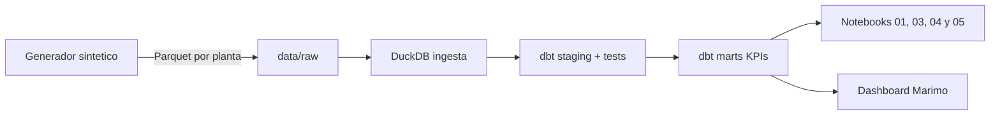
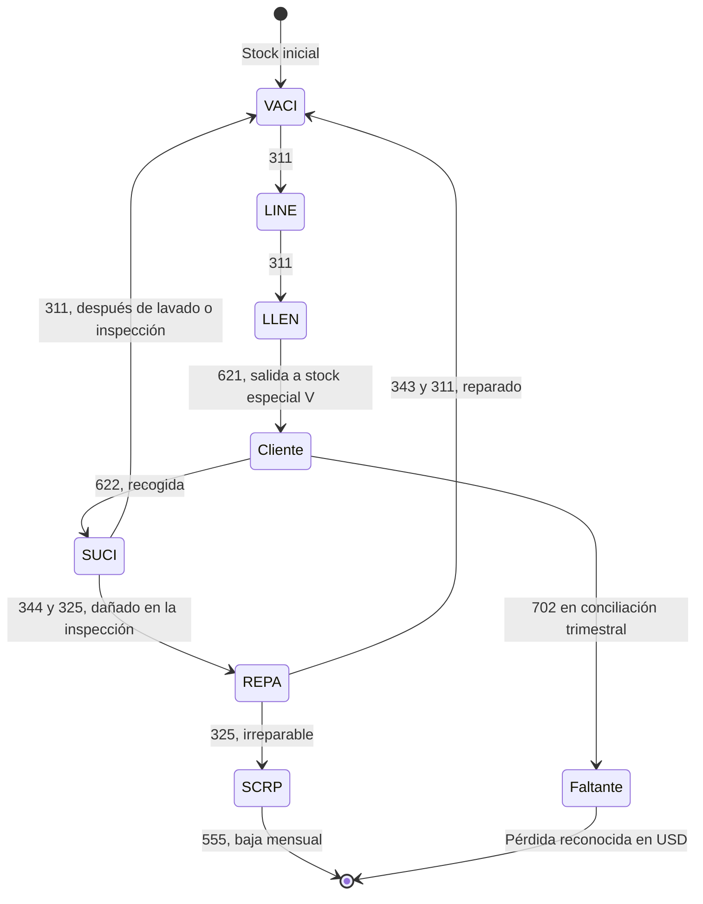
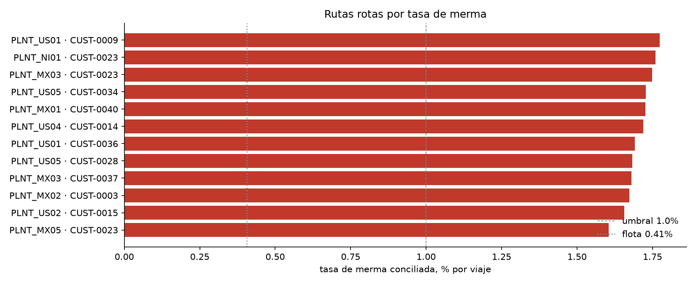
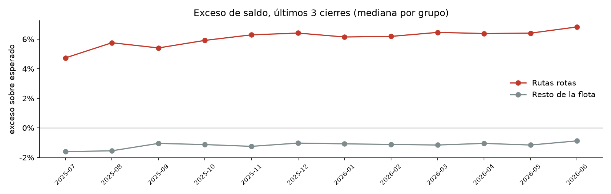
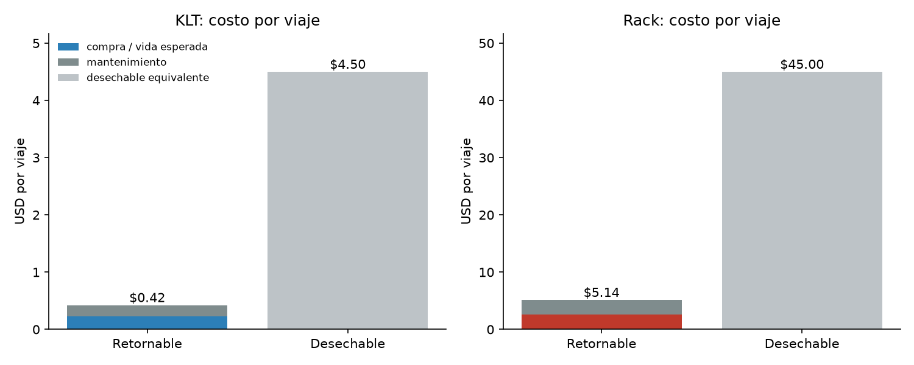
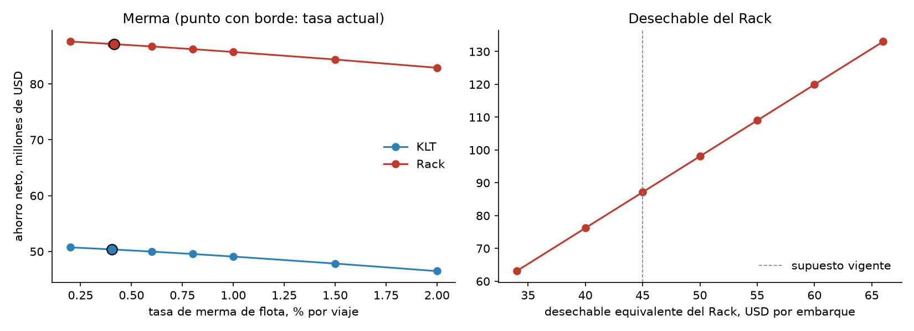
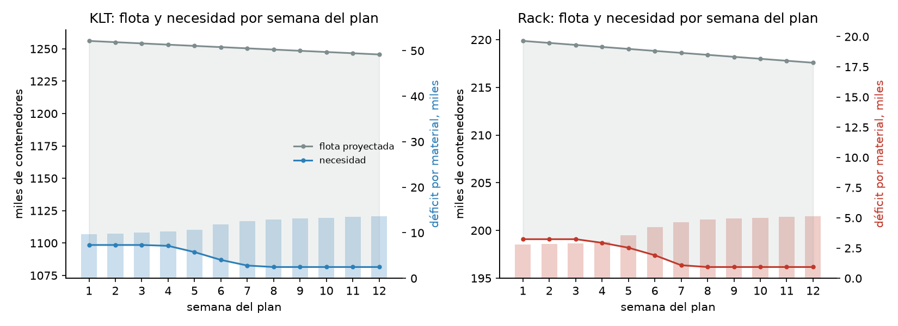
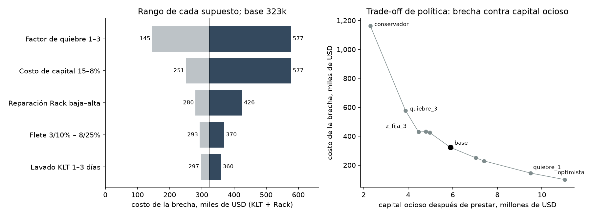
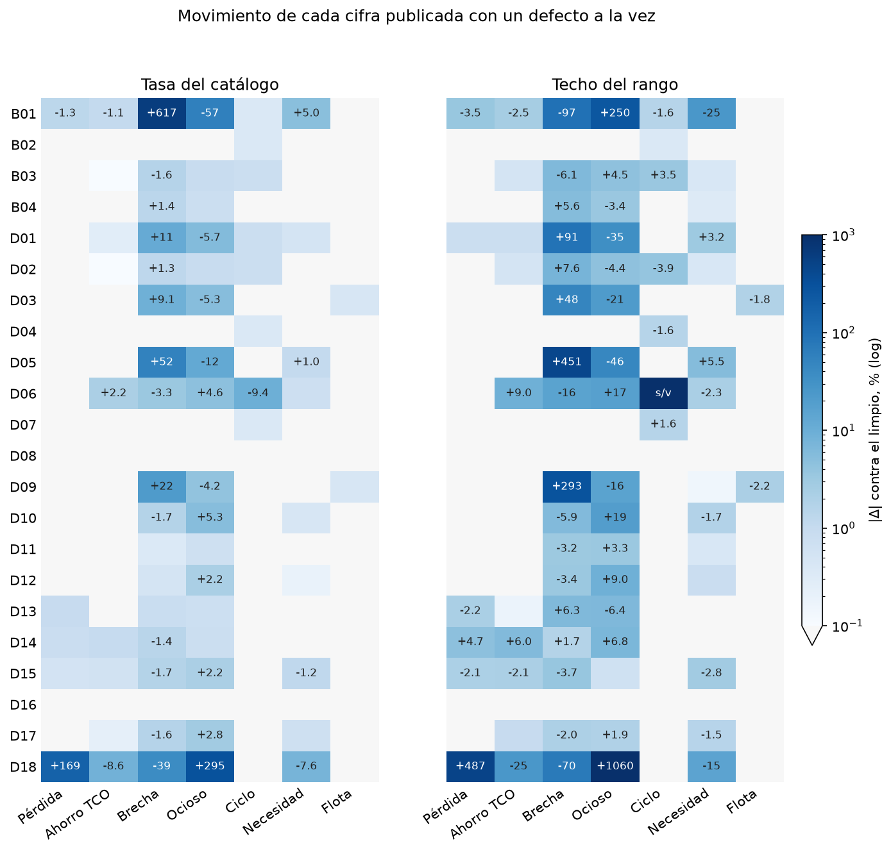

# returnable-packaging-intelligence


Análisis de ciclo, saldo en cliente y pérdidas de contenedores retornables en una flota multi-planta, sobre movimientos MB51 sintéticos. Modela una operación de Returnable Packaging Logistics (RPL) automotriz: 14 plantas entre México, Estados Unidos y Nicaragua, 1,200 materiales de empaque, 18 meses de historia y 20,981,396 movimientos.

El objetivo es llegar a KPIs que un equipo de gobernanza de RPL pueda usar: cuánto se pierde en USD, qué rutas planta × cliente concentran la pérdida, qué rutas acumulan saldo en cliente antes de que la conciliación lo reconozca y cuánto ahorra el retornable contra un desechable equivalente.

## Disclaimer

Todos los datos de este repositorio son **sintéticos**. Se generan por código a partir de reglas de negocio publicadas en `PROYECTO.md`. No provienen de ningún sistema SAP productivo, ni de datos anonimizados de ningún empleador pasado o presente. El generador se encuentra en `src/rpi/` y es reproducible: seed 42 y fecha de corte fija al 2026-06-30. Nada se emite después del corte.

## Problema

Los proveedores Tier-1 automotrices manejan flotas de contenedores retornables (racks metálicos, KLTs plásticos) que ciclan entre planta y cliente. En SAP el contenedor que sale a cliente se lleva como stock especial V: sale con 621, regresa con 622 y el faltante se reconoce con 702 cuando se concilia el saldo. Con una merma de fracciones de punto por viaje y unos 14 viajes al año, cada año se va una parte visible de la flota. Mientras no se concilia, esos contenedores siguen en el saldo como si fueran a volver.

MB51 registra cada movimiento, pero por sí solo no responde:

- ¿Cuántos días tarda un contenedor en volver de cliente? (ciclo 621→622)
- ¿Qué rutas planta × cliente concentran la pérdida?
- ¿Qué rutas acumulan más saldo del esperado antes de la siguiente conciliación?
- ¿Cuánto cuesta un viaje en retornable contra uno en desechable, con la merma incluida?

Este proyecto construye el pipeline analítico que sí responde esas preguntas.

## Approach

Batch, no streaming. Pipeline reproducible corrido localmente sin infraestructura cloud.



Linaje de los modelos dbt:

```mermaid
flowchart LR
    raw[raw_mb51] --> stg[stg_mb51]
    rawsi[raw_stock_inicial] --> stgsi[stg_stock_inicial]
    rawplan[raw_partes, raw_instruccion_empaque, raw_plan_produccion] --> stgplan[stg_partes, stg_instruccion_empaque, stg_plan_produccion]
    rawm[raw_maestro_materiales] --> stgm[stg_maestro_materiales]
    grupos[seed grupos_material] --> stgm
    stgm --> stg
    stgm --> stgsi
    stgm --> stgplan
    stg --> mov[int_mov_cuenta]
    stg --> tcoi[int_tco_por_material]
    stg --> perd[mart_perdidas_usd]
    stg --> mrutas[mart_rutas]
    mov --> fifo[int_tramos_fifo]
    fifo --> sup[int_supervivencia_retorno]
    mov --> cuenta[int_cuenta_mensual]
    sup --> cuenta
    fifo --> mrutas
    mrutas --> rutas[mart_rutas_rotas]
    mov --> rot[mart_rotacion_planta]
    fifo --> rot
    sup --> rot
    fifo --> ciclo[mart_ciclo_cohortes]
    rot --> ciclo
    cuenta --> exceso[mart_exceso_saldo_ruta]
    mov --> exceso
    sup --> exceso
    tcoi --> tco[mart_tco_comparativo]
    seeds[seeds almacenes y clases_movimiento] --> movs[int_mov_stock]
    stg --> movs
    stgsi --> movs
    movs --> diario[int_stock_diario]
    diario --> flota[mart_flota_semanal]
    diario --> uso[int_uso_diario]
    uso --> var[int_variabilidad_uso]
    var --> curva[int_curva_z]
    params[seeds parametros_flota y escenarios_brecha] --> zeco[int_z_economico]
    curva --> zeco
    stgplan --> dem[int_demanda_plan]
    var --> dem
    dem --> nesc[int_necesidad_escenario]
    zeco --> nesc
    nesc --> nec[mart_necesidad_flota]
    dem --> proy[int_flota_proyectada]
    flota --> proy
    mrutas --> proy
    proy --> bal[int_balance_material]
    nesc --> bal
    bal --> prest[int_prestamos]
    prest --> besc[int_brecha_escenario]
    nesc --> besc
    besc --> brecha[mart_brecha_flota]
    besc --> sens[mart_sensibilidad_brecha]
    prest --> red[mart_red_prestamos]
    stg --> cal[int_calidad_mb51, _stock_inicial, _plan, _maestro]
    stgm --> cal
    stgplan --> cal
    cal --> viol[int_calidad_violaciones]
    reglas[seeds reglas_calidad y prefijos_material] --> viol
    errs[raw_errores_schema] --> viol
    viol --> mcal[mart_calidad_datos]
    csv[docs/calidad/impacto_defectos.csv] --> stgi[stg_impacto_defectos]
    stgi --> mimp[mart_impacto_defectos]
    reglas --> mimp
    antes[docs/calidad/ciegos_antes.csv] --> stga[stg_ciegos_antes]
    stga --> mdet[mart_deteccion_ciegos]
    stgi --> mdet
    reglas --> mdet
```



Ciclo de un contenedor retornable, dentro de la planta y con el cliente:



Dentro de la planta el contenedor se mueve con 311 entre vacíos (VACI), línea (LINE), llenos (LLEN) y sucios (SUCI), un documento por día, material y tramo. Lo que sale dañado de la inspección se bloquea con 344 y pasa a reparación (REPA) con 325; de ahí regresa a vacíos con 343 y 311, o va a scrap (SCRP) y se da de baja con 555 el último día hábil del mes. Entra a reparación el 2% de los KLT recogidos y el 5.5% de los Rack; el scrap anual queda en 1.18% y 1.91% de la flota. MB51 no trae el stock con el que abre la ventana, así que la flota arranca de una foto al 2025-01-05, equivalente a MB5B: el mínimo que deja vacíos sin quedar negativo durante los 18 meses, más una holgura de 0 a 30% por material. El cartón es desechable: sale con 601 y no regresa, así que no entra al ciclo ni al TCO.

El generador produce los movimientos con reglas explícitas: ciclo 621→622 log-normal con cola larga, merma de 0.5% por viaje concentrada en ~20% de las cuentas, conciliación trimestral y lag Cpudt/Budat con distribución 92/6/2. Los parámetros están en `PROYECTO.md` sección 4.

El tipo de empaque y el costo unitario salen de un maestro de materiales por planta, con los campos de MARA, MARC y MBEW que importan aquí: tipo de material, grupo de artículos, unidad, precio y unidad de precio. El grupo de artículos se mapea a KLT, Rack o cartón en un seed, así que un extracto real con Matnr numérico se clasifica sin tocar modelos (ADR-028).

Los modelos no emparejan salida con retorno por documento: los contenedores son fungibles y ningún MB51 real lo permite. El ciclo sale de un saldo por cuenta planta × cliente × material con antigüedad FIFO; la merma, de la tasa conciliada; y el saldo esperado en cliente, de la curva de supervivencia del ciclo (ADR-011 y ADR-012).

## Stack

Elegí este stack apuntando a un pipeline analítico reproducible sin depender de infraestructura administrada. Los ADRs con contexto y alternativas descartadas están en `PROYECTO.md` sección 3.

| Capa | Herramienta | Por qué |
|------|-------------|---------|
| DataFrames | Polars | Lazy y multihilo; el generador escribe 21M filas sin salir del laptop. |
| Warehouse local | DuckDB | Motor OLAP embebido. Cero infraestructura. |
| Modelado analítico | dbt-duckdb | Linaje, tests y docs auto-generados. |
| Validación de schemas | Pandera | Contrato de estructura de las seis tablas de entrada, validado en modo lazy en la ingesta. |
| Generación sintética | NumPy | Distribuciones por parámetro con seed fijo. |
| Persistencia | Parquet | Columnar comprimido, un archivo por planta. |
| Package manager | uv | Setup en segundos. Reemplaza pip + venv + poetry. |
| Lint + format | Ruff | Rápido, opinado, un solo binario. |
| Tests | pytest + pytest-cov | Estándar. |
| CI | GitHub Actions | Lint, generador reducido, dbt build y pytest en cada push. |
| Dashboard | Marimo | Notebook reactivo en `.py` plano: diffs legibles en Git, corre como app. |

Explícitamente descartado: Pandas, Airflow, Postgres, Snowflake. Ver ADRs para el razonamiento.

## Requisitos

- Python 3.11 o superior.
- [uv](https://github.com/astral-sh/uv) instalado.
- Git.
- 8 GB de RAM. `profiles.yml` limita DuckDB a 4GB y 4 threads; arriba de eso escribe a disco en lugar de fallar.

## Reproducir el pipeline completo

Clonar y levantar el entorno:

```bash
git clone https://github.com/juancarlospradologistica-hub/returnable-packaging-intelligence.git
cd returnable-packaging-intelligence
uv sync
```

Generar el dataset sintético (14 plantas, 18 meses, 20,981,396 filas, la foto de stock inicial, el plan de producción de 12 semanas y el maestro de materiales):

```bash
uv run python -m rpi
```

`uv run python -m rpi --help` lista las opciones: horizonte, número de plantas, país, merma, seed, defectos y directorio de salida.

Con `--defectos todos` (o una lista como `--defectos D05,D13`) el generador inyecta el catálogo de defectos de un extracto real (ADR-028) y escribe `data/raw/bitacora_defectos.parquet` con cada registro que tocó. Apagado por default: sin la opción el dataset sale igual.

Con `--defectos ciegos` inyecta cuatro defectos más, que medí antes de que existiera una regla para ellos (ADR-033, ADR-034): Matnr y Kunnr con ceros a la izquierda desde una fecha, un documento 621 contabilizado otra vez con otro número y salidas con fecha de contabilización posterior a la del extracto. `--defectos todos,ciegos` enciende los 22.

Ingestar a DuckDB (MB51, stock inicial, plan y maestro de materiales). Cada tabla pasa por su schema Pandera; una falla de estructura no detiene la carga y queda en `raw_errores_schema`. MB51, foto y maestro son obligatorios; partes, instrucción y plan no: si falta el archivo, su tabla queda vacía y la necesidad de flota sale sin filas (ADR-037):

```bash
uv run python -c "from rpi.db import ingest; ingest()"
```
> Si generaste el dataset con `--output` en un directorio distinto a `data/raw`, pasa el argumento correspondiente: `from rpi.db import ingest; ingest(raw_dir="data/custom")`.

Construir modelos y correr los tests de dbt (47 modelos, 10 seeds, 300 tests de datos y 31 unit tests):

```bash
uv run dbt build --profiles-dir .
```

Correr los tests de Python:

```bash
uv run pytest tests/ -v
```

Medir las reglas de calidad contra los defectos inyectados, en una base aparte para no tocar la limpia (`RPI_DB` la leen la ingesta, `profiles.yml` y los tests; en PowerShell, `$env:RPI_DB = "data/sucio.duckdb"`):

```bash
export RPI_DB=data/sucio.duckdb
uv run python -m rpi --defectos todos,ciegos --output data/sucio
uv run python -c "from rpi.db import ingest; ingest(raw_dir='data/sucio')"
uv run dbt seed --profiles-dir .
uv run dbt run --profiles-dir .
uv run dbt test --profiles-dir . --select tag:calidad --vars '{calidad_reporte: true}'
uv run pytest tests/test_calidad.py -v -s
```

Cada regla vive en `models/intermediate/calidad/` y su severidad en `seeds/reglas_calidad.csv`: una que bloquea truena `dbt build`; una alerta solo avisa. Con `calidad_reporte` las dos avisan, y `test_calidad.py` exige que cada registro de la bitácora lo reporte la regla de su defecto.

`mart_calidad_datos` junta las violaciones por regla, planta y material. Con una regla que bloquea encima de una cifra, los notebooks se detienen y el dashboard cambia la sección por un aviso con las reglas (ADR-031). Para verlo, abre el dashboard con `RPI_DB` todavía apuntando a la base con defectos:

```bash
uv run marimo run notebooks/02_dashboard.py
```

Medir cuánto mueve cada defecto, solo, cada cifra publicada (ADR-031). El arnés inyecta cada defecto sobre el limpio de `data/raw`, a la tasa del catálogo y en el techo de su rango, reconstruye solo lo que cambió y escribe `docs/calidad/impacto_defectos.csv`. Sin opciones mide los 22 defectos: en el completo son 45 corridas y ~115 min. Corre en local al cerrar una fase, no en CI:

```bash
uv run python -m rpi.calidad
uv run python -m rpi.calidad --defectos D05,D13 --niveles tasa   # corrida corta
```

`docs/calidad/ciegos_antes.csv` es la medición de los ciegos antes de tener regla. No se vuelve a correr: es el antes contra el que `mart_deteccion_ciegos` compara la detección de hoy.

El CSV de impacto va versionado: `mart_impacto_defectos` lo publica y sus tests revisan en cada build que la severidad y las cifras de `seeds/reglas_calidad.csv` digan lo que el arnés midió. `notebooks/05_calidad_datos.ipynb` lo lee: detección por defecto, cuánto mueve cada defecto cada cifra, valor expuesto contra delta, la severidad contra el supuesto de materialidad y los ciegos antes y después de su regla. El dashboard tiene una pestaña "Calidad de datos" con el tablero del extracto abierto y la misma medición.

Abrir el dashboard:

```bash
uv run marimo run notebooks/02_dashboard.py
```

### Cargar un extracto de SAP

`rpi.extracto` convierte el MB51, el maestro de materiales y la foto de stock bajados de SAP al contrato que escribe el generador, en `data/extracto/raw`, que la ingesta lee igual que `data/raw`. Los tres esperan CSV con los campos técnicos de las tablas de SAP, que no cambian con el idioma del usuario, y los formatos de un usuario estándar de SAP: separador `;`, fecha DD.MM.AAAA y notación 1.234,56. Otros formatos van con `--separador`, `--decimal` y `--fecha`; otros encabezados, con `--columnas`.

#### MB51

Un Parquet por planta, con los campos de MSEG y MKPF:

```bash
uv run python -m rpi.extracto mb51 data/extracto/MB51.csv
uv run python -m rpi.extracto mb51 MB51.csv --separador , --decimal . --fecha %m/%d/%Y
uv run python -m rpi.extracto mb51 MB51.csv --columnas mapeo.csv
```

- Obligatorios: WERKS, MATNR, MAKTX, BWART, BUDAT, CPUDT, CPUTM, MENGE, MEINS, MBLNR y ZEILE. Opcionales: LGORT, MJAHR, LIFNR, KUNNR, XBLNR, SHKZG, DMBTR y WAERS. Si falta un obligatorio, la conversión se detiene con la lista.
- El signo sale de SHKZG (H es salida). Sin SHKZG sale de la cantidad, con el menos atrás como lo exporta el ALV (`5-`). CPUTM puede venir HHMMSS o HH:MM:SS.
- `--columnas` es un CSV `columna,campo` para un archivo con otros encabezados, por ejemplo `Material,MATNR`.
- La unidad interna de SAP se traduce con `seeds/unidades_extracto.csv` (ST es PC). Una unidad que no está en el seed pasa como viene y la marca el schema en la ingesta.
- El precio es DMBTR entre la cantidad, solo en USD. Un LEIH estándar no lleva importe: el precio queda nulo y el costo sale del maestro (ADR-028).

El adaptador cambia nombres, formatos y signo, pero no corrige datos. Un Matnr con ceros a la izquierda o un Budat después del corte pasan como vienen, para que los vean sus reglas (ADR-034). Una línea sin WERKS detiene la conversión: no tiene archivo de planta y tirarla sería corregir el extracto.

La fecha de extracción la da quien corrió el extracto, y se pasa a dbt:

```bash
uv run dbt build --profiles-dir . --vars "{fecha_extraccion: '2026-09-30'}"
```

Lo probé con ida y vuelta: el MB51 completo del generador, escrito como lo exporta SAP (CSV de 2.6 GB, 21M de líneas), regresa idéntico planta por planta en 50 s, con 2.6 GB de pico de memoria. `data/extracto/` está en `.gitignore`.

#### Maestro de materiales

```bash
uv run python -m rpi.extracto maestro data/extracto/maestro.csv
uv run python -m rpi.extracto maestro maestro.csv --moneda USD
```

Una fila por material asignado a la planta, con los campos de MARA, MARC, MAKT y MBEW: WERKS, MATNR, MAKTX, MTART, MATKL, MEINS y PEINH, más el precio. El precio es VERPR o STPRS según el control de precio VPRSV (V medio variable, S estándar). Un LEIH sin valorar trae el del registro info, EINE.NETPR, que se mapea a VERPR con `--columnas`. WAERS es la moneda de la sociedad y no está en MBEW; sin la columna, `--moneda` la da para todo el archivo.

#### Foto de stock

```bash
uv run python -m rpi.extracto foto 30.06.2026 --almacen MARD.csv --cliente MSKU.csv
```

El stock por almacén sale de MARD (WERKS, LGORT, MATNR y la suma de LABST, UMLME, INSME, EINME, SPEME y RETME que vengan) y el stock V en cliente, de MSKU (WERKS, KUNNR, MATNR, KULAB, KUINS y KUEIN; si trae SOBKZ, solo las filas V). El pipeline pide la foto del día anterior al primer movimiento del MB51, y esa nadie la tiene a la mano: lo que cualquiera baja de MMBE o SE16N es el stock del día del extracto. Con esa fecha, el adaptador regresa la foto con el MB51 ya convertido: stock al cierre menos lo que se movió en la ventana. Regresa los almacenes del ciclo y los que traiga la foto, porque un almacén vacío al cierre no aparece en MARD. Con la foto del día anterior a la ventana la escribe como viene; con una fecha a la mitad se detiene.

MARD trae el stock de todos los materiales del almacén: baja la foto con la misma selección de materiales que el MB51, o `material_sin_maestro` marca los que sobran.

#### De punta a punta

Lo probé con la ventana recortada del completo armada como la bajaría alguien de SAP: MB51 en CSV, MARD y MSKU del día del extracto y el maestro, sin plan. Los tres adaptadores corren en 50 s y sus 16 archivos salen idénticos a los de la ventana. dbt build pasa completo, los 11 marts que no dependen del plan salen iguales fila por fila y los cuatro de necesidad, brecha, sensibilidad y red de préstamos, vacíos. El dashboard cambia la pestaña de necesidad por un aviso.

### Un extracto abre con contenedores en cliente

El generador arranca con los clientes vacíos: todos los ciclos 621→622 empiezan dentro de la ventana. Un MB51 real no. El primer día ya hay contenedores afuera, y los 622 de los primeros meses recogen lo que salió antes. Por eso la foto inicial lleva dos cosas: el stock por almacén, como MB5B, y el stock especial V por cliente y material, como MSKU, en filas con Kunnr y sin almacén.

Con ese stock V las cuentas abren con su saldo, y en el FIFO lo que ya estaba afuera es lo más viejo: la primera recogida lo cierra antes que cualquier salida de la ventana. Su ciclo no se mide, porque no se sabe cuándo salió. En las rutas que abren con stock en cliente, la tasa de merma cuenta desde la primera conciliación cuyas salidas son todas posteriores a la foto. Las anteriores reconocen faltantes de viajes que la ventana no ve (ADR-036).

Para probarlo, `rpi.recorte` corta el limpio en una fecha y arma la foto con lo que pasó antes:

```bash
uv run python -m rpi.recorte 2025-04-07
uv run python -c "from rpi.db import ingest; ingest(raw_dir='data/recorte')"
uv run dbt build --profiles-dir .   # con RPI_DB=data/recorte.duckdb
uv run pytest tests/test_recorte.py -v
```

`test_recorte.py` exige que, sobre la ventana recortada, el saldo por cuenta, el stock diario, el ciclo de las salidas posteriores al corte, la flota semanal, la variabilidad, la z y la necesidad salgan iguales que con los 18 meses, y que la brecha y el capital ocioso queden dentro de la materialidad del 1%. Corre en CI. Lo único que cambia es lo que se estima con historia: la tasa de merma y la curva de supervivencia, con menos conciliaciones y menos ciclos.

La z se calibra con una estimación de 26 semanas antes de dos tramos de 13 (ADR-025), así que un extracto necesita un año de MB51 más los días para cerrar semanas completas: con la fecha de extracción de este dataset, 52.3 semanas si la foto trae el stock V. Sin él son 13 semanas más, porque se descartan mientras se llena el saldo en cliente. Con menos historia `assert_calendario_necesidad_valido` detiene el build.

## Estructura del repo

```
returnable-packaging-intelligence/
├── .github/workflows/
│   └── ci.yml                  # lint + generador CI + dbt build + pytest en cada push
├── data/
│   ├── raw/                    # Parquet por planta, stock inicial, plan y maestro (excluido de Git)
│   ├── extracto/               # Extracto bajado de SAP y su conversión (excluido de Git)
│   ├── recorte/                # El limpio desde una fecha, con la foto al corte (excluido de Git)
│   └── sinplan/                # El limpio sin partes, instrucción ni plan; lo arma CI (excluido de Git)
├── docs/
│   ├── calidad/                # impacto_defectos.csv y ciegos_antes.csv: mediciones versionadas del arnés
│   └── img/                    # Gráficas que escriben los notebooks
├── macros/                     # fórmula de necesidad, fecha de extracción y tipos de la medición del arnés
├── models/
│   ├── staging/
│   │   ├── sources.yml
│   │   ├── stg_maestro_materiales.sql  # tipo de empaque y costo unitario (fuente única)
│   │   ├── stg_mb51.sql
│   │   ├── stg_stock_inicial.sql
│   │   ├── stg_partes.sql
│   │   ├── stg_instruccion_empaque.sql
│   │   └── stg_plan_produccion.sql
│   ├── intermediate/
│   │   ├── int_mov_cuenta.sql              # movimientos de stock especial V por cuenta
│   │   ├── int_tramos_fifo.sql             # salida → cierre con antigüedad FIFO
│   │   ├── int_supervivencia_retorno.sql   # curva S(edad) por tipo
│   │   ├── int_cuenta_mensual.sql          # saldo real y esperado por cierre
│   │   ├── int_tco_por_material.sql        # insumos TCO: costo del maestro, política del seed
│   │   ├── int_mov_stock.sql               # movimiento → ubicación y tipo de stock
│   │   ├── int_stock_diario.sql            # saldo por almacén y tipo al cierre del día
│   │   ├── int_calendario_necesidad.sql    # ventanas de la necesidad y del backtest
│   │   ├── int_uso_diario.sql              # stock fuera de vacíos por día natural
│   │   ├── int_variabilidad_uso.sql        # ciclo T y σ del stock en uso
│   │   ├── int_curva_z.sql                 # días con quiebre por z en el tramo de calibración
│   │   ├── int_z_economico.sql             # z por costo y escenario
│   │   ├── int_demanda_plan.sql            # contenedores por día del plan, ciclo y σ
│   │   ├── int_necesidad_escenario.sql     # necesidad por escenario con la macro de ADR-021
│   │   ├── int_flota_proyectada.sql        # flota menos merma pendiente y pérdida por viaje
│   │   ├── int_balance_material.sql        # déficit pico y sobrante prestable
│   │   ├── int_prestamos.sql               # préstamos entre plantas, por país y entre países
│   │   ├── int_brecha_escenario.sql        # compra, desechable y USD por escenario
│   │   └── calidad/                        # reglas por causa por objeto y violaciones con severidad
│   └── marts/
│       ├── mart_perdidas_usd.sql
│       ├── mart_rotacion_planta.sql
│       ├── mart_ciclo_cohortes.sql
│       ├── mart_rutas.sql
│       ├── mart_rutas_rotas.sql
│       ├── mart_exceso_saldo_ruta.sql
│       ├── mart_tco_comparativo.sql
│       ├── mart_flota_semanal.sql
│       ├── mart_necesidad_flota.sql
│       ├── mart_brecha_flota.sql
│       ├── mart_sensibilidad_brecha.sql
│       ├── mart_red_prestamos.sql
│       ├── mart_calidad_datos.sql   # violaciones por regla, planta y material
│       ├── mart_impacto_defectos.sql  # impacto de cada defecto por cifra, tasa y techo
│       └── mart_deteccion_ciegos.sql  # detección de los ciegos antes y después de su regla
├── seeds/                      # catálogos SAP, unidades de un extracto, plantas, política, escenarios, reglas de calidad y cifras publicadas
├── notebooks/
│   ├── 00_sanity_check.ipynb
│   ├── 01_analisis_perdidas.ipynb
│   ├── 02_dashboard.py         # Dashboard Marimo
│   ├── 03_tco_analysis.ipynb
│   ├── 04_necesidad_flota.ipynb
│   └── 05_calidad_datos.ipynb  # detección, impacto por cifra y severidad medida
├── src/rpi/
│   ├── __main__.py             # CLI del generador
│   ├── calidad.py              # Arnés de impacto: un defecto a la vez contra el limpio
│   ├── config.py               # Parámetros del generador (Pydantic)
│   ├── db.py                   # Ingesta Parquet → DuckDB
│   ├── defectos.py             # Catálogo de defectos inyectables y bitácora
│   ├── extracto.py             # Adaptadores: MB51, maestro y foto de SAP al contrato de entrada
│   ├── generator.py            # Generador sintético MB51, stock inicial, plan y maestro
│   ├── huella.py               # Huella de 621, 622 y 702 para detectar cambios de cifras
│   ├── publicacion.py          # Bloqueo de cifras con una regla de calidad que bloquea
│   ├── recorte.py              # Ventana recortada: el limpio desde una fecha, con la foto al corte
│   └── schema.py               # Schemas Pandera: MB51, foto, plan y maestro
├── tests/                      # pytest: generador, defectos, arnés, extracto, ventana recortada, extracto sin plan, ciclo interno, plan, huella, schema, marts, bloqueo, dashboard y cuadre del README
├── tests_dbt/                  # tests singulares de dbt y el genérico de severidad
├── dbt_project.yml
├── profiles.yml                # DuckDB con rutas relativas para CI
├── pyproject.toml
└── README.md
```

## Resultados Fase 1: ciclo y pérdidas

14 plantas, 18 meses con corte al 2026-06-30, seed 42.

| KPI | Valor |
|-----|-------|
| Pérdida reconocida (702) | $2,238,765 USD |
| Contenedores perdidos | 45,853 |
| Pérdida Rack / KLT | $1,268,640 / $970,125 |
| Tasa de merma de flota | 0.405% por viaje |
| Rutas rotas | 12 de 71 |
| Pérdida en rutas rotas | $1,385,315 (62%) |
| Ciclo de flota | promedio 25.6 días, p50 25, p90 35 |

La tasa de merma es faltante entre salidas 621 que ya pasaron por una conciliación. Es por viaje, no anual.

El Rack es 15% de los contenedores perdidos y 57% del dinero. Un Rack cuesta $180 y un KLT $25: perder un Rack equivale a perder 7.2 KLT. Si hay que priorizar dónde poner control de flota, empiezo por racks.

La pérdida cae en escalones: el 702 se registra en la conciliación trimestral, así que la serie mensual muestra el calendario de conciliación, no la tendencia de merma.

### Rutas rotas

Una ruta planta × cliente está rota si su merma conciliada supera 1.0% por viaje o su ciclo promedio supera 45 días. El umbral es el tope del rango de industria; el supuesto y su rango están en ADR-012.



Las 12 rutas rotas van de 1.60% a 1.77% por viaje, contra 0.405% de la flota. Son 17% de las rutas y 62% de la pérdida. La que más pierde es PLNT_US04 · CUST-0014 con 1.72%. Hoy ninguna entra por ciclo: el generador no tiene ciclo heterogéneo por ruta.

### Alerta temprana: exceso de saldo en cliente

La tasa conciliada llega tarde, porque una ruta tiene que pasar por una conciliación para que su faltante se vea. La señal previa es el exceso de saldo: saldo real en stock especial V contra el saldo esperado por la curva de supervivencia del ciclo.



El indicador suma los últimos 3 cierres, igual al periodo de conciliación. Un cierre aislado no sirve: en el mes de conciliación el 702 borra el exceso acumulado y la ruta rota se ve sana.

- Rutas rotas: exceso mediano de +4.7% a +6.8%.
- Resto de la flota: de −1.6% a −0.9%.
- Las rutas rotas quedan arriba del resto en los 12 cierres válidos.

El resto de la flota no queda en cero sino alrededor de −1.2%. Es un sesgo del saldo esperado que pega parejo en toda la flota: no cambia el orden de la alerta, pero el exceso no se lee como merma absoluta. Es alerta, no clasificador; la ruta rota se define por tasa conciliada.

### Ciclo de retorno

Días entre 621 y 622 con antigüedad FIFO, ponderados por contenedor, solo en cohortes de salida completas. Los percentiles se calculan sobre la distribución completa, no como promedio de percentiles mensuales (ADR-014).

El promedio casi no se mueve entre plantas (25.3 a 26.1 días). La diferencia está en la cola: el p90 por planta va de 33 a 39 días.

El análisis completo está en `notebooks/01_analisis_perdidas.ipynb`.

## Resultados Fase 2: TCO retornable vs desechable

La pregunta de Fase 2: con compra, mantenimiento y merma incluidos, ¿cuánto cuesta un viaje en retornable contra hacer el mismo embarque con un desechable equivalente?

El costo por viaje del retornable es su compra repartida entre su vida esperada más el mantenimiento. La merma no se resta aparte: un contenedor que se pierde deja de dar viajes, así que su compra se reparte entre menos. E[vida] = (1 − (1 − p)^V) / p, con p la tasa de merma por viaje y V la vida útil (ADR-011, punto 8).



| | KLT | Rack |
|---|---:|---:|
| Viajes, 18 meses | 12,355,872 | 2,186,377 |
| Merma por viaje | 0.404% | 0.415% |
| Vida esperada (vida útil) | 113.9 (150) ciclos | 68.5 (80) ciclos |
| Costo por viaje retornable | $0.42 | $5.14 |
| Desechable equivalente | $4.50 | $45.00 |
| Ahorro por viaje | $4.08 | $39.86 |
| Payback | 6 viajes | 5 viajes |
| Ahorro neto, 18 meses | $50.4M | $87.1M |

El ahorro neto de la flota retornable contra desechable es **$137.5M USD** en 18 meses. Ese número depende del volumen; el que se defiende es el ahorro por viaje.

Observaciones:

- El Rack corre menos de una quinta parte de los viajes del KLT y genera 1.7 veces su ahorro.
- Los dos recuperan su compra en 5–6 viajes. Con un ciclo de ~26 días son unos 5 meses de operación. Ninguna de las 28 combinaciones planta × tipo deja de recuperar la compra.
- La pérdida reconocida de Fase 1 ($2,238,765) ya está dentro del costo por viaje vía vida esperada. Se reporta como KPI propio y no se resta otra vez. El notebook 03 verifica que la pérdida reconocida del TCO cuadre con la de Fase 1.

### Supuestos

| Parámetro | KLT | Rack |
|---|---:|---:|
| Costo unitario (USD) | 25.00 | 180.00 |
| Vida útil (ciclos) | 150 | 80 |
| Mantenimiento por ciclo (USD) | 0.20 | 2.50 |
| Desechable equivalente (USD) | 4.50 | 45.00 |

El costo unitario sale del maestro de materiales; vida útil, mantenimiento y desechable equivalente, de `seeds/parametros_flota.csv` (ADR-028).

### Desechable equivalente del Rack

Un rack metálico no tiene sustituto desechable directo. Para compararlo armé el empaque de un solo uso que haría el mismo trabajo en un embarque:

| Componente | Rango de mercado (USD) | Usado |
|---|---:|---:|
| Caja corrugada triple pared (bulk bin) | 18–30 | 22 |
| Tarima de madera de un solo uso | 10–20 | 12 |
| Dunnage interior (separadores, espuma) | 5–12 | 8 |
| Consumibles (película stretch, fleje, etiquetas) | 1–4 | 3 |
| **Total** | **34–66** | **45** |

Son rangos de orden de magnitud, no cotizaciones: cambian por región, volumen y tamaño de pieza. Asumo que una carga de rack equivale a un embarque desechable.

### Sensibilidad



- **Desechable del Rack.** Es el supuesto que más mueve el resultado. Con el rango $34–66 el ahorro del Rack va de $63.1M a $133.1M; cada dólar del supuesto mueve $2.2M.
- **Merma.** Entre 0.2% y 2.0% por viaje el ahorro total se mueve $9.0M. Con 2.0%, cinco veces la tasa actual, el Rack sigue en $82.9M y el KLT en $46.5M.
- **Equilibrio.** El Rack deja de convenir con un desechable por debajo de $5.14 por embarque en la flota y de $5.55 en la planta con más merma. El piso del rango ($34) queda muy arriba de los dos.

Payback, sensibilidad y resumen ejecutivo en `notebooks/03_tco_analysis.ipynb`. El dashboard Marimo tiene una pestaña TCO con el detalle por planta.

## Resultados Fase 3a: flota dentro de la planta

La flota se reconstruye como en SAP: foto inicial (MB5B) más movimientos MB51. `int_stock_diario` lleva el saldo por planta, material, almacén y tipo de stock al cierre de cada día con cambio, y `mart_flota_semanal` lo corta por semana. Un test de dbt valida en cada material y semana que la flota solo baja por faltante en cliente (702) y por baja de scrap (555).

| Flota | KLT | Rack | Total |
|---|---:|---:|---:|
| Inicial al 2025-01-05 | 1,330,136 | 235,839 | 1,565,975 |
| Faltante en cliente (702) | 38,805 | 7,048 | 45,853 |
| Baja por scrap (555) | 23,268 | 6,659 | 29,927 |
| Al corte, 2026-06-30 | 1,268,063 | 222,132 | 1,490,195 |
| En cliente al corte (stock V) | 576,621 | 102,700 | 679,321 |

En 18 meses la flota pierde 4.8%: 4.7% en KLT y 5.8% en Rack. En el Rack la baja por scrap ya pesa casi lo mismo que el faltante (6,659 contra 7,048), porque entra a reparación casi tres veces más que el KLT. El sintético no tiene compras de reposición: la pérdida sale de la holgura de la flota inicial. En 3b se mide contra el plan.

Dos efectos de borde, del sintético y no de la operación:

- **Arranque.** El stock V abre en cero porque el generador no tiene 621 antes de la ventana. Llega a régimen en unas 13 semanas.
- **Corte.** LINE y LLEN quedan en cero el 2026-06-30: los 621 posteriores al corte no existen y sus 311 tampoco. Los ~80k contenedores que normalmente están en línea y llenos aparecen en vacíos. Para comparar contra necesidad uso flota o vacíos + línea + llenos, no vacíos solo.

## Resultados Fase 3b: necesidad de flota contra el plan

Necesidad por planta, material y semana del plan de 12 semanas (2026-07-06 a 2026-09-27): d_plan × ciclo + z × σ del stock en uso, con el ciclo por ley de Little y σ de 52 semanas (ADR-021, ADR-023). La z no es un número redondo: sale de la razón crítica entre quedarse corto un día (desechable × factor de quiebre / ciclo) y tener un contenedor de más (costo de capital), se calibra contra el stock en uso de 13 semanas y se valida en las 13 siguientes, fuera de muestra (ADR-025).

La flota proyectada es la del corte menos la merma que la conciliación todavía no reconoce y menos lo que se pierde por viaje del plan. La brecha se escala en tres niveles: préstamo entre plantas con el mismo material (primero dentro del país), compra al corte de lo que falta y desechable mientras la compra llega.

| Necesidad y brecha | KLT | Rack |
|---|---:|---:|
| z por costo | 2.70 | 2.90 |
| Necesidad semana 1 | 1,098,502 | 199,087 |
| Flota proyectada semana 12 | 1,245,651 | 217,588 |
| Materiales en déficit | 972 | 607 |
| Déficit pico | 17,066 | 5,608 |
| Préstamo dentro del país | 14,369 | 4,283 |
| Préstamo entre países | 1,147 | 582 |
| Compra | 1,592 | 790 |
| Viajes en desechable | 793 | 1,346 |
| Costo de la brecha | $65,630 | $257,046 |
| Capital ocioso | $3.2M | $2.7M |



En total sobra flota: 15.2% sobre la necesidad en KLT y 10.9% en Rack a la semana 12. Material por material, no: 972 KLT y 607 Rack quedan cortos en alguna semana. El préstamo cubre el 89.9% del déficit y cubrir la brecha cuesta $322.7k. Después de prestar quedan $5.9M de flota parada, 18 veces el costo de la brecha. La red no tiene un problema de tamaño; tiene la flota en el material y la planta equivocados.

En Rack el desechable ($60,590) cuesta 43% de la compra ($142,200): la compra tarda 12 semanas y casi todo el horizonte se cubre en cartón. Los Rack con algún arranque en el plan son 19% de los materiales y cargan 57% del costo de la brecha; si hay que decidir qué comprar, empiezo por ahí.

### Sensibilidad

Cada escenario de `seeds/escenarios_brecha.csv` corre por la misma lógica que el base y queda en `mart_sensibilidad_brecha` (ADR-026).



- **Factor de quiebre.** Es el supuesto que más mueve: de $145k con factor 1 a $577k con factor 3. La z depende del cociente entre factor y costo de capital, así que capital al 8% da lo mismo que factor 3.
- **Trade-off.** Optimista (factor 1, capital 15%): $100k de brecha y $11.0M ociosos. Conservador (factor 3, capital 8%): $1,162k y $2.3M. Con z = 3 fija, la de ADR-021: $429k y $4.5M.
- **Lavado del KLT.** Un día hábil de lavado vale 31,962 contenedores de necesidad, $0.80M a costo unitario. Con 1 a 3 días la brecha KLT va de $40k a $103k. Es la única palanca del análisis que libera flota en lugar de comprarla.
- **Días de cobertura.** El piso de 7 días, el techo del rango, no manda en ninguna de las 80,352 filas: el stock de seguridad más corto es de 8.3 días en KLT y 7.6 en Rack.

Escalamiento, red de préstamos entre plantas y curva de la z en `notebooks/04_necesidad_flota.ipynb`. El dashboard tiene una pestaña con la brecha de cada escenario.

## Resultados Fase 4: calidad de datos

La pregunta de Fase 4: qué defecto de un extracto MB51 y de su maestro rompe cada cifra de Fase 1 a 3, si el pipeline lo detecta por su causa y cuánto mueve cada cifra publicada (ADR-027). Al cerrar Fase 3, de 13 defectos típicos el pipeline detectaba seis por su causa, cuatro solo por síntoma y dos pasaban en silencio.

El catálogo tiene hoy 22 defectos y cada uno tiene una regla en dbt que lo nombra: los 18 de Fase 4 y cuatro ciegos que medí antes de tener regla (Fase 4c, más abajo). El arnés `rpi.calidad` inyecta cada defecto solo sobre el dataset limpio, a la tasa del catálogo y en el techo de su rango, y mide siete cifras publicadas, cuatro identidades (llave, stock, saldo en cliente y conservación de flota) y las reglas que se disparan: 45 corridas en 114 min. Con cada defecto solo, la regla de su defecto reporta el 100% de lo inyectado en los dos niveles. Para los 18 de Fase 4 ese 100% se mide contra defectos que conocía al escribir sus reglas; los ciegos dicen qué pasa con los que no.

| Defecto | Regla | Severidad | Identidad rota | Más mueve a tasa | En el techo |
|---|---|---|---|---|---|
| D01 | `llave_duplicada` | bloquea | llave, stock, saldo | Brecha +11.4% | Brecha +90.8% |
| D02 | `bwart_fuera_de_catalogo` | bloquea | stock, saldo | Brecha +1.3% | Brecha +7.6% |
| D03 | `lgort_fuera_de_catalogo` | bloquea | stock, conservación | Brecha +9.1% | Brecha +47.9% |
| D04 | `cliente_vacio` | bloquea | saldo | Ciclo -0.4% | Ciclo -1.6% |
| D05 | `signo_invertido` | bloquea | stock, conservación | Brecha +52.4% | Brecha +451.2% |
| D06 | `cantidad_en_piezas` | bloquea | stock | Ciclo -9.4% | Ciclo sin valor |
| D07 | `recogida_sin_saldo` | bloquea | saldo | Ciclo +0.4% | Ciclo +1.6% |
| D08 | `registro_despues_del_cierre` | alerta | — | nada | nada |
| D09 | `material_sin_foto` | bloquea | stock | Brecha +21.9% | Brecha +293.4% |
| D10 | `parte_sin_instruccion` | bloquea | — | Ocioso +5.3% | Ocioso +19.4% |
| D11 | `piezas_en_cero` | bloquea | — | Ocioso +0.7% | Ocioso +3.3% |
| D12 | `instruccion_a_desechable` | bloquea | — | Ocioso +2.2% | Ocioso +9.0% |
| D13 | `unidad_de_precio` | bloquea | — | Pérdida -0.9% | Ocioso -6.4% |
| D14 | `grupo_contradice_codigo` | bloquea | — | Brecha -1.4% | Ocioso +6.8% |
| D15 | `material_sin_maestro` | bloquea | — | Ocioso +2.2% | Brecha -3.7% |
| D16 | `precio_documento_distinto` | alerta | — | nada | nada |
| D17 | `grupo_fuera_de_catalogo` | bloquea | — | Ocioso +2.8% | Brecha -2.0% |
| D18 | `moneda_distinta` | bloquea | — | Ocioso +294.9% | Ocioso +1060.4% |
| B01 | `matnr_con_formato` | bloquea | stock, saldo | Brecha +616.8% | Ocioso +250.0% |
| B02 | `kunnr_con_formato` | bloquea | saldo | Ciclo -0.4% | Ciclo -0.4% |
| B03 | `documento_repetido` | bloquea | stock | Brecha -1.6% | Brecha -6.1% |
| B04 | `budat_despues_del_corte` | bloquea | saldo | Brecha +1.4% | Brecha +5.6% |



Lo que encontré:

- **Un precio en otra moneda es el defecto más caro.** Una planta con el maestro en MXN leído como USD (D18) sube la pérdida reconocida +169.3% y el capital ocioso +294.9%. Antes de Fase 4 no tronaba ningún test.
- **El signo importa más que el volumen.** El signo invertido (D05) mueve la brecha +52.4% a la tasa del catálogo y +451.2% en el techo.
- **Una cifra puede desaparecer.** Con la cantidad capturada en piezas (D06) el ciclo de flota baja -9.4%; en el techo no queda ninguna cohorte completa y el ciclo de Fase 1 no se puede publicar.
- **El capital ocioso es la cifra más frágil.** La mueven 17 de los 22 defectos: sale del mismo balance que la brecha y cualquier cosa que cambie flota o necesidad lo mueve.
- **El valor expuesto no dice cuánto se mueve una cifra.** D06 expone $16.1M y mueve 4.6% una cifra en USD; D05 expone $1.1M y mueve la brecha 52.4%. La correlación de rangos entre los dos, en los 19 defectos con valor expuesto, es 0.22. El valor expuesto sirve para priorizar la revisión; el impacto lo mide el arnés.
- **Las falsas alarmas tienen dueño.** Con el defecto solo, D01, D02 y D04 dejan 6,235, 3,130 y 1,584 recogidas sin saldo: rompen el saldo de la cuenta y la regla de D07 lo ve. No son errores de esa regla.

La severidad del seed coincide con la medición en los 22 defectos y un test la revisa en cada build. Doce bloquean por romper una identidad; D11 y D13 bloquean solo por lo que mueven en el techo de su rango. La severidad no cambia mientras la materialidad quede debajo de 2.84%; con 5%, D11, D15 y D17 pasarían a alerta.

Con los 22 defectos encendidos las nueve cifras quedan bloqueadas: los notebooks 01, 03 y 04 se detienen en la primera celda y el dashboard cambia cada sección por un aviso con las reglas. Detección por defecto, valor expuesto contra impacto y sensibilidad a la materialidad en `notebooks/05_calidad_datos.ipynb`; el dashboard tiene la pestaña "Calidad de datos".

### Defectos ciegos: antes y después de su regla

Las reglas de Fase 4 las escribí conociendo los 18 defectos, así que su 100% no dice nada de un defecto que nadie anticipó. Para medirlo inyecté cuatro defectos de un extracto real que ninguna regla nombraba y medí su detección en el completo antes de escribir sus reglas (ADR-033). Esa medición está en `docs/calidad/ciegos_antes.csv`, en un commit anterior al de las reglas: el historial muestra que no la ajusté después. Luego escribí las cuatro reglas y volví a medir con la misma inyección (ADR-034).

| Qué simula | Ciego | Casos a tasa | Antes de su regla | Después |
|---|---|---:|---|---|
| Matnr con ceros a la izquierda desde una fecha | B01 | 209,117 | `material_sin_maestro` 140, `recogida_sin_saldo` 3,100 | `matnr_con_formato` 100% |
| Kunnr de las recogidas con ceros desde una fecha | B02 | 293,408 | `recogida_sin_saldo` 293,408 | `kunnr_con_formato` 100% |
| Documento 621 contabilizado otra vez con otro número | B03 | 3,968 | ninguna regla | `documento_repetido` 100% |
| Budat después de la fecha del extracto | B04 | 1,987 | `recogida_sin_saldo` 5 | `budat_despues_del_corte` 100%; también `recogida_sin_saldo` 5 |

- **Detección por su causa: 0 de 4 antes, 4 de 4 después**, a la tasa del catálogo y en el techo, sin violaciones en el limpio.
- **Antes, 3 de los 4 disparaban una regla de otro defecto, con el nombre equivocado.** B02 disparaba `recogida_sin_saldo` en cada una de sus líneas: quien lee eso busca un error en la recogida, no un cliente que cambió de formato. Ahora cada línea responde a una sola regla.
- **B03 solo lo veía el test de stock no negativo.** Por contenido no se distingue de dos embarques iguales del mismo día; la regla usa la entrega (`Xblnr`): la misma salida con la misma entrega, contabilizada dos veces.
- **B04 movía la brecha +31.0% con cualquier volumen.** Cuatro modelos tomaban el corte de `max(Budat)`, y una sola línea con fecha posterior corría todo el calendario: 1,987 líneas movían lo mismo que 7,940. Con la fecha de extracción como var, +1.4% a tasa y +5.6% en el techo.
- **Límites.** `documento_repetido` necesita que el extracto traiga `Xblnr`. `kunnr_con_formato` toma como buena la versión del cliente que tiene salidas; si las dos tienen, no marca ninguna.

## Estado

Fase 1 (ciclo y pérdidas) y Fase 2 (TCO retornable vs desechable) cerradas sobre la base corregida de ADR-011: ciclo con 621/622/702, saldo por cuenta con antigüedad FIFO y generador reproducible. Pipeline de punta a punta: generador sintético → DuckDB → 47 modelos dbt y 10 seeds con 300 tests de datos y 31 unit tests → notebooks → dashboard Marimo con cuatro pestañas.

Fase 3a cerrada: ciclo del empaque dentro de la planta en el generador (traslados entre vacíos, línea, llenos y sucios, reparación, scrap con baja mensual y foto de stock inicial) y modelos dbt de stock por almacén y flota semanal con conservación validada. Las cifras de Fase 1 y 2 no cambian: una huella de los movimientos 621, 622 y 702 lo verifica en cada corrida.

Fase 3b cerrada: plan de 12 semanas derivado de los embarques, con instrucción de empaque y reglas de calidad de datos; necesidad de flota con stock de seguridad por variabilidad y z escogida por costo, validada fuera de muestra; flota proyectada con merma pendiente; brecha en USD por nivel de escalamiento, red de préstamos y sensibilidad por escenarios (ADR-021 a ADR-026).

Fase 4 cerrada: calidad de datos sobre MB51 y maestro de materiales. El tipo de empaque y el costo unitario salen del maestro, sin mover ninguna cifra de Fase 1 a 3 (ADR-028). El generador inyecta 18 defectos de un extracto real con su bitácora (ADR-029); cada uno tiene una regla en dbt que lo nombra por su causa, con la severidad en un seed (ADR-030). El arnés de impacto mide cuánto mueve cada defecto cada cifra, y los tests revisan en cada build que la severidad y las cifras afectadas del seed digan lo que el arnés midió. Ningún notebook ni el dashboard presentan una cifra con una regla que bloquea sobre ella (ADR-031, ADR-032).

Fase 4c cerrada: defectos ciegos (ADR-033, ADR-034). Cuatro defectos de un extracto real que ninguna regla nombraba se midieron antes de escribir sus reglas, con 0 de 4 detectados por su causa, y después, con 4 de 4. La fecha de extracción pasó a ser un dato de entrada en lugar de inferirse del MB51. El simulador de la red queda para Fase 5.

Fase 4d cerrada: extracto real. MB51, maestro y foto de SAP al contrato, cada uno con ida y vuelta exacta (ADR-035, ADR-037). La foto trae el stock en cliente con el que abre un extracto real y una ventana recortada da lo mismo que la completa (ADR-036). El plan de producción es opcional: sin él la necesidad no se calcula y todo lo demás sale igual. Un extracto armado como lo baja SAP corre de punta a punta sin el generador.

Roadmap completo por semanas en `PROYECTO.md` sección 5.

## Licencia

MIT. Ver `LICENSE`.
